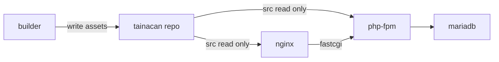

# Architecture

Why this environment is shaped the way it is. This page explains; it does not
instruct. For commands, see [Make targets](../reference/make-targets.md).

## The problem

Tainacan is a WordPress plugin with a build step. The plugin repository root is a
development workspace; WordPress loads `src/`. Assets are produced by webpack and
Sass into `src/assets/`, and PHP dependencies by Composer into `src/vendor/`.

A development environment therefore has to satisfy two different needs at once:
PHP must be editable with zero ceremony, and assets must be rebuildable quickly.

## Two live loops

The PHP loop is a plain bind mount. A file saved on the host is the same file
php-fpm reads, so there is nothing to synchronise and nothing to remember to run.

The asset loop is a separate container that owns write access to the source tree
and recompiles into it. Splitting the two means PHP never waits on a build, and
the build never competes with the web process for file ownership.

## Why the sources are read-only for the web tier

The plugin directory is mounted into the WordPress web root. That is precisely the
direction in which generated files can leak back into a source repository:
plugin updates, stray caches, debug logs, an accidental core file.

Mounting `tainacan/src` read-only for the `wordpress` and `nginx` services
removes the possibility rather than relying on
discipline. A write attempt fails with `Read-only file system`. Only the builder
container has a read-write mount, and it is not reachable over HTTP.

This is a deliberate trade-off: if the plugin ever needed to write cache files
into its own directory at runtime, that write would be denied. Tainacan's runtime
writes go to the database and the uploads volume, so in practice this costs
nothing and buys a hard guarantee.

## Why php-fpm behind nginx

nginx serves static files directly from the shared volume and proxies PHP to
php-fpm over FastCGI. This mirrors a common production topology, so the local
request path resembles deployment more closely than a single Apache container
would, and it keeps the web server and the PHP runtime independently
configurable.

The official WordPress PHP image already bundles every extension Tainacan needs
(imagick, exif, gd, mbstring, curl, xml, zip, intl), so the custom layer is only
PHP limits. That is why the image builds in seconds.

## Why WordPress core is in a named volume

Core, `wp-config.php` and uploads live in `wordpress_data`, a Docker named
volume. Nothing about a WordPress installation belongs in a plugin repository,
and keeping core off the host makes that structurally impossible rather than
merely discouraged. The host exposes exactly one directory to the stack: the
plugin source.

## Why the builder runs PHP 8.3

The plugin's Composer lock file pins dependencies that require PHP 8.3 (for
example `maennchen/zipstream-php`). Debian bookworm ships PHP 8.2, so the builder
image installs PHP 8.3 from the Sury repository rather than the distribution
package. Keeping the builder's CLI on the same version as the
`wordpress:php8.3-fpm` runtime means `composer install` and the PHPUnit run use
the exact PHP that WordPress serves.

The plugin's own `build.sh` gates `composer install` behind a checksum file and
writes that file even when the install fails, which can leave `src/vendor`
missing while the gate believes the step is done. `make vendor` is the
environment's guard against that: it installs the dependencies whenever
`tainacan/src/vendor/autoload.php` is absent.

## Why the watchers poll

Docker Desktop on macOS does not deliver inotify events from host files into
Linux containers. A watcher built on `inotifywait` appears to work and then
silently misses every host edit. Polling every two seconds is slower and less
elegant, but it is correct on macOS and still correct on Linux, which matters
because contributors use both.

## Where hardening lives

Hardening is applied with `wp config set` during `make setup`, writing real
constants into `wp-config.php`: `WP_HOME`, `WP_SITEURL`,
`AUTOMATIC_UPDATER_DISABLED`, `WP_AUTO_UPDATE_CORE` and `DISALLOW_FILE_EDIT`.

The image also supports `WORDPRESS_CONFIG_EXTRA`, but that value is `eval`ed at
runtime by the image's config template, so it never appears in the file and
cannot be inspected by `var_dump` or `wp config get`. A containment guarantee that
cannot be verified is a weak guarantee, so the file-based path won.

## Why core is updated during setup

WordPress core lives in `wordpress_data`, which is seeded from the image the
first time the volume is created and then keeps that version for its lifetime.
Left alone it drifts behind the image and the admin shows the "Please update now"
notice.

The environment converges instead of hiding: `make setup` runs `wp core update`
and `wp core update-db` right after install, so the volume moves to the latest
release while background auto-updates remain disabled. The update is visible and
repeatable, not suppressed.

## Detection as the last line

Even with read-only mounts and hardening, `make guard` scans both checkouts for
WordPress core artifacts and fails if any appear. Structural prevention plus an
on-demand check covers the case where a future change weakens one of the earlier
layers.

## Related

- [Make targets](../reference/make-targets.md) for the interface.
- `AGENTS.md` for the full map, including plugin internals and testing.
- `.agents/memories/` for the decisions recorded when this stack was built.
