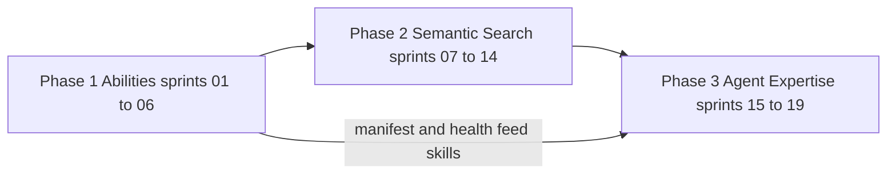

# Sprint roadmap

The sprint board for the three phases described in
[`../explanation/abilities-and-rag.md`](../explanation/abilities-and-rag.md).
That page is the design; this page is the order of execution.

`AGENTS.md` covers the repository rules that every sprint gate enforces. Sprint
work on plugin code is committed inside the `tainacan/` submodule; sprint pages
and stack changes are committed here.

## How sprints are structured

- One sprint delivers a **coherent, gateable increment**. A sprint that cannot
  pass its gate is not finished, and the next sprint does not start on red.
- Every sprint page has: goal, scope with acceptance criteria, dependencies,
  gate plan, and exit criteria.
- Findings are logged, not intentions. If a planned task turned out wrong, the
  sprint page records what actually happened and why.
- No level-of-effort estimates. Scope and exit criteria only.

## The gate

Adapted from the 3-gate harness to this stack. All three gates are mandatory
before a sprint is closed, and results are recorded on the sprint page.

**Gate 1 — Build and load**

```sh
make guard
make assets                      # no-op if nothing changed
make wp ARGS="eval 'echo TAINACAN_VERSION;'"
```

Pass: containment check clean, assets built, plugin loads and reports its
version without a fatal. A `Tainacan: Class X not found` in `make logs` is a
Gate 1 failure, not a warning — it is the autoloader telling you a filename or
directory is wrong.

**Gate 2 — Tests and smoke**

```sh
make test
make wp ARGS="eval 'echo count( wp_get_abilities() );'"
```

Pass: PHPUnit suite green, and the behaviour the sprint claims is observable
through `wp_get_ability()` / `WP_Ability::execute()` or the REST route. For
sprints that touch background processing, `make bg-loopback` and a real queue
drain are part of Gate 2, because a process stuck in `waiting` looks identical to
success from the admin UI.

**Gate 3 — Checkpoint**

- Commit inside `tainacan/` with a message prefixed `sprint-N:`.
- Sprint page updated: tasks marked, gate results pasted, findings appended.
- One line appended to [`../progress/activity-log.md`](../progress/activity-log.md).
- Status flipped on the board below.

## Board

Status legend: `planned`, `active`, `done`, `blocked`.

### Phase 1 — Tainacan Abilities

| Sprint | Goal | Work breakdown | Depends on | Status |
|---|---|---|---|---|
| [01](sprint-01-foundation-and-bridge.md) | Ability foundation: namespace, hooks, categories, REST bridge | 1.1, 1.2 | — | done |
| [02](sprint-02-tier1-content.md) | Tier 1 content abilities: collections, items, publish lifecycle, item metadata values | 1.3 | 01 | done |
| [03](sprint-03-tier1-structure.md) | Tier 1 structure abilities: metadata, sections, taxonomies, terms, filters, facets, read-only lists | 1.4 | 01 | done |
| [04](sprint-04-media-and-ingest.md) | Media and ingest: upload, get, set document, extraction path | 1.5 | 02 | done |
| [05](sprint-05-workflows.md) | Workflow abilities: scaffold, create-with-metadata, batch create, bulk status | 1.6 | 02, 03, 04 | done |
| [06](sprint-06-phase1-close.md) | Full coverage, MCP exposure and import/export sessions: escape hatch, `meta.public`, annotations, client verification | 1.7, 1.8 | 01–05 | done |

### Phase 2 — Tainacan Semantic Search

| Sprint | Goal | Work breakdown | Depends on | Status |
|---|---|---|---|---|
| [07](sprint-07-environment-gate.md) | Environment gate: probes, cached verdict, requirements verdict | 2.1 | 06 | done |
| [08](sprint-08-vector-spaces.md) | Vector spaces: registry migration, dynamic per-space tables, ANN index | 2.2 | 07 | done |
| [09](sprint-09-embedding-providers.md) | Providers: contract, OpenAI-compatible base, OpenAI and Ollama, dimension reporting | 2.3 | 08 | done |
| [10](sprint-10-indexing-pipeline.md) | Chunking and indexing: chunker, hashing, queue, change capture, immediate removal | 2.4, 2.5 | 09 | done |
| [11](sprint-11-resilience.md) | Resilience: resumable backfill and provider circuit breaker | 2.6 | 10 | done |
| [12](sprint-12-retrieval.md) | Retrieval: space-scoped `Semantic_Search` with post-ANN visibility filtering | 2.7 | 11 | done |
| [13](sprint-13-admin-console.md) | Admin console: spaces, indexing status, search preview, storage estimates | 2.8 | 12 | done |
| [14](sprint-14-hybrid-and-answers.md) | RAG abilities and hybrid search inside `Search_Engine` | 2.9, 2.10 | 13 | done |

### Phase 3 — Agent expertise

| Sprint | Goal | Work breakdown | Depends on | Status |
|---|---|---|---|---|
| 15 | Manifest, health ability, least-privilege role, connection guide | 3.1, 3.2, 3.3, 3.8 | 14 | planned |
| 16 | Skills library, seven `SKILL.md` files in the house style | 3.4 | 15 | planned |
| 17 | Seven workflow playbooks with preflight, verification and rollback | 3.5 | 16 | planned |
| 18 | Assisted authoring and the trust-boundary test suite | 3.6, 3.7 | 15 | planned |
| 19 | Hand-off audit playbook and release checkpoint | 3.9 | 17, 18 | planned |

## Dependency shape



Phase 2 cannot begin before the gate in Sprint 7 exists, because the gate is what
decides whether MariaDB on the target host supports `VECTOR` at all. Phase 3
cannot begin before the manifest exists, because skills that name abilities
without a generated manifest become folklore within one release.

## Phase acceptance tests

| Boundary | Test |
|---|---|
| End of Phase 1 | An agent-style script creates a collection, uploads items with files, sets metadata, publishes, and reads them back |
| End of Phase 2 | With a configured space, indexing a collection then querying returns ranked items and never returns one the user cannot read |
| End of Phase 3 | An agent with no prior Tainacan knowledge reads the artifacts, builds and loads a collection, enables semantic search, and audits its own work |
